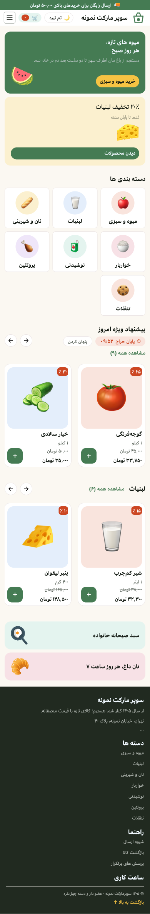

# big-o


A Persian (right-to-left) grocery shop built with React, TypeScript and Vite.

**Live site:** https://big-o-shop.vercel.app



## Run locally

Run these commands from the project folder (the one that contains `package.json`):

```
npm install
npm run dev
```

Then open http://localhost:5173 in your browser.

## Run with Docker

You need Docker Desktop installed and running. Run these commands from the project folder (the one that contains the `Dockerfile`):

```
docker build -t big-o-shop .
docker run -d -p 8080:80 --name shop big-o-shop
```

Then open http://localhost:8080 in your browser.

To stop and remove the container:

```
docker stop shop && docker rm shop
```

### Run the published image

The pipeline publishes the image to GitHub Container Registry on every push to `main`.
You can run the shop without cloning the code:

```
docker run -d -p 8080:80 --name shop ghcr.io/fatemehtayebisalar/big-o-shop:1.0.0
```

Open http://localhost:8080. Stop it with `docker stop shop && docker rm shop`.