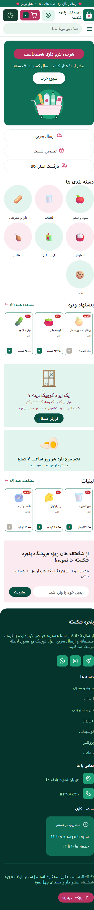

#  پنجره شکسته

پنجره شکسته یک فروشگاه اینترنتی سوپرمارکت با رابط فارسی و راست‌چین است؛ فهرست محصولات، دسته‌بندی‌ها و پیشنهادها را نشان می‌دهد.


🔗 **سایت زنده:** https://broken-windows-shop.vercel.app/



## اجرا

```bash
npm install
npm run dev
```

سپس آدرسی را که ترمینال نشان می‌دهد در مرورگر باز کنید.

## اجرا با Docker

ابتدا Docker Image را بسازید:

```bash
docker build -t broken-windows-shop .
```

سپس کانتینر را اجرا کنید:

```bash
docker run -d -p 8080:80 --name shop broken-windows-shop
```

پس از اجرا، فروشگاه از آدرس زیر در دسترس خواهد بود:

http://localhost:8080

برای متوقف کردن و حذف کانتینر:

```bash
docker stop shop && docker rm shop
```