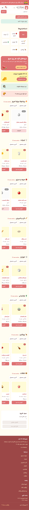

# Clean Market


Clean Market is a Persian grocery shop. Fresh, nearby, affordable, and online.

Live site: https://clean-code-shop-elm1cvece-fafa-5955.vercel.app/



## Run

```bash
npm install
npm run dev
```

## Run with Docker

```bash
docker build -t clean-code-shop .
docker run -d -p 8080:80 --name shop clean-code-shop
```

## Why with Docker

The shop is a static build. The image builds it with Node, then serves only `dist/` with nginx. The running container does not need Node or this machine's `node_modules`, so the same image is what the deploy pipeline runs.

```bash
docker build -t clean-code-shop .
docker run -d -p 8080:80 --name shop clean-code-shop
```
