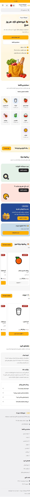

# سوپرمارکت بوی کد

[](https://github.com/mahsa-mousavinia/code-smell-shop/actions/workflows/deploy.yml)

سوپرمارکت فارسی و راست‌چین با جست‌وجوی کالا و سبد خرید، ساخته‌شده با React، TypeScript و Vite.

[نسخهٔ آنلاین فروشگاه](https://code-smell-shop.vercel.app/)

## اجرای محلی

در پوشهٔ فروشگاه، فایل `.env.development.local` را بسازید و این مقدار را داخل آن قرار دهید.

```dotenv
VITE_API_URL=/api
```

سپس از همان پوشه اجرا کنید.

```bash
npm install
npm run dev
```

آدرس پیش‌فرض فروشگاه [localhost:5173](http://localhost:5173/) است.

## اجرا با Docker

دستورهای زیر را از داخل پوشهٔ فروشگاه اجرا کنید.

```bash
docker build -t code-smell-shop .
docker run -d -p 8080:80 --name code-smell-shop code-smell-shop
```

بعد از اجرای کانتینر، فروشگاه را باز کنید. [localhost:8080](http://localhost:8080/)

### اجرا با Image منتشر شده

برای اجرای نسخه ی `1.0.0` از GitHub Container Registry، این دستور را اجرا کنید.

```bash
docker run -d -p 8080:80 ghcr.io/mahsa-mousavinia/code-smell-shop:1.0.0
```

سپس فروشگاه را باز کنید. [localhost:8080](http://localhost:8080/)


## نمای موبایل

