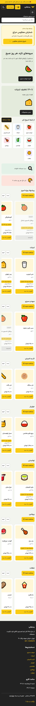

# Batshop / composition

فروشگاه مواد غذایی فارسی و راست‌به‌چپ با React، TypeScript و Vite.

[](https://github.com/hamed-abbassi/composition-shop/actions/workflows/deploy.yml)

نسخهٔ آنلاین فروشگاه در [Vercel](https://composition-shop.vercel.app/) در دسترس است.



## راه‌اندازی و اجرای محلی

Node.js 22 و npm را نصب کنید و دستورهای زیر را داخل پوشهٔ فروشگاه اجرا کنید.

در یک کپی تازه، فایل محلی `.env.development` را در کنار `package.json` بسازید و در آن بنویسید:

```dotenv
VITE_API_URL=/api
```

برای `npm run build` و پیش‌نمایش محلی هم همین خط را در `.env.production` قرار دهید. در GitHub Actions و Docker این متغیر هنگام ساخت تنظیم می‌شود.

```bash
npm ci
npm run dev
```

نشانی پیش‌فرض سرور توسعه [http://localhost:5173](http://localhost:5173) است. Vite درخواست‌های `/api/` را به API فروشگاه هدایت می‌کند.

برای ساخت و پیش‌نمایش نسخهٔ تولید، این دستورها را اجرا کنید.

```bash
npm run build
npm run preview
```

برای اجرای بررسی‌های CI در محیط محلی، از `npm run ci` استفاده کنید.

## اجرا با Docker

این دستورها را داخل پوشهٔ فروشگاه اجرا کنید:

```bash
docker build -t composition-shop .
docker run -d -p 8080:80 --name shop composition-shop
```

فروشگاه در http://localhost:8080 در دسترس است. درخواست‌های `/api/` توسط Nginx به API فروشگاه هدایت می‌شوند.
آدرس عمومی API هنگام ساخت تنظیم می‌شود؛ فایل‌های `.env*` وارد ایمیج نمی‌شوند.

برای توقف و حذف کانتینر:

```bash
docker stop shop
docker rm shop
```

### اجرای نسخهٔ منتشرشده از GHCR

پس از انتشار ایمیج و عمومی شدن پکیج، برای اجرای نسخهٔ 1.0.0 روی سیستمی که Docker دارد:

```bash
docker run -d -p 8080:80 --name composition-ghcr ghcr.io/hamed-abbassi/composition-shop:1.0.0
```

فروشگاه را در http://localhost:8080 باز کنید.
