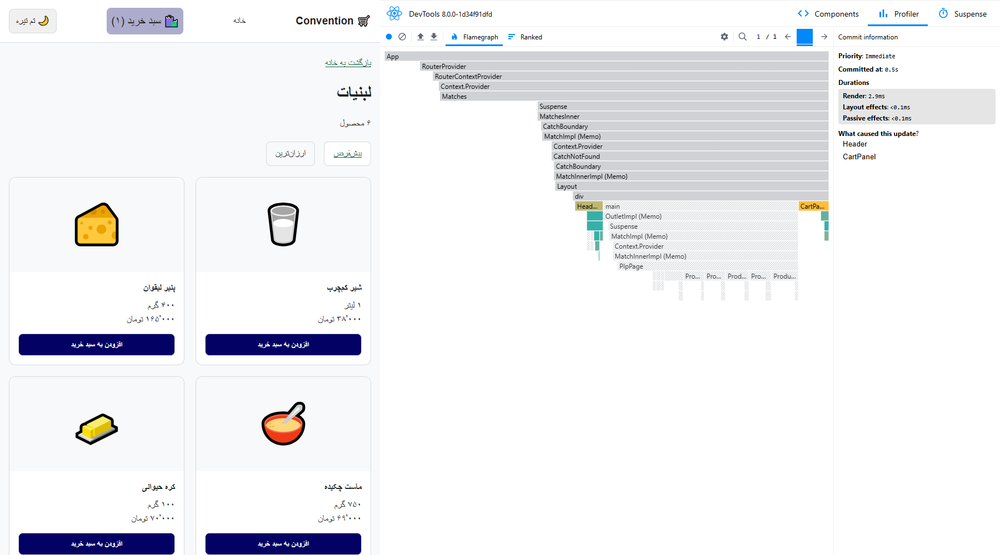

# Convention - Week 6

## Routes

Routes are declared in `src/App.tsx`, the architecture entry point permitted to import pages.
TanStack Router registration types every Link and parameter. Pages read parameters through
`useParams({ from })`, avoiding an import cycle with App. Hash history preserves nested shop
URLs on static hosting and supports refresh, Back and Forward.

| Address | Page | Data |
| --- | --- | --- |
| `/` | HomePage | useCatalog; home.json carousels; category navigation; local search |
| `/plp/$carouselId` | PlpPage | useParams; useCatalog; carouselProducts |
| `/product/$productId` | ProductPage | numeric route ID; useCatalog; related products |
| `/checkout` | CheckoutPage | shared cart; useCatalog; controlled CheckoutForm |
| unmatched | NotFound | Return-home link |

Unknown list IDs display “این فهرست پیدا نشد”; empty lists remain valid lists.
Home rows show at most four products and link to the complete list with its total count.
Category navigation also accepts category slugs from categories.json.

## Stores and data

| Store | Defined in | State | Writers | Persistence |
| --- | --- | --- | --- | --- |
| Theme | hooks/useThemeStore.ts | light/dark | ThemeToggle calls toggle | Zustand persist, convention-theme |
| Cart | hooks/useCartStore.ts | CartItem[] only | ProductCard/ProductPage add; CartPanel remove; CheckoutForm clear | storage/cart-storage.ts, convention-cart |

Zustand was chosen for the cart because consumers subscribe to independent selectors without
providers or prop passing. Count and totals are derived; pure cart functions remain in cart/.
Header reads only the count, cards only the stable add action, and CartPanel reads lines.
`useThemeStore()` subscribes to every update; `useThemeStore(s => s.theme)` subscribes only
to the selected theme. Theme colors are CSS variables on Layout's wrapping div, not document.
Hooks never access document. Browser storage is isolated in storage/ or persist middleware.

useCatalog returns the LoadState discriminated union plus a stable retry action. A shared
in-flight request and memory snapshot avoid duplicate loads across all pages and CartPanel.
useSyncExternalStore subscribes each consumer; retry publishes loading/success/error to all
consumers together. React unsubscribes on unmount, protecting against late results. Empty
results retain the empty state on navigation. Requests remain in api/; selection and immutable
price sorting remain in catalog/. All API JSON is validated as unknown without casts.
Vite dev and preview serve the root repository API files through a read-only middleware because
the former remote proxy returned HTTP 502. Deployment still uses ../../api from the shop URL.

## Component trees

```text
App -> RouterProvider -> Layout
  Header -> ThemeToggle
  main -> Outlet
    HomePage -> CategoryNav, SearchBox, SaleCountdown, CarouselRow -> ProductCard
    PlpPage -> ProductCard
    ProductPage -> ProductCard (related products)
    CheckoutPage -> CheckoutForm
    NotFound -> home Link
  CartPanel
```

ProductCard is memoized and reads only the stable add selector. Cart changes update Header
and CartPanel; they do not change page props or card subscriptions. Theme changes update the
Layout wrapper; CSS variables propagate the new palette.

## Verification

Run from shops/convention: npm run check, npm run lint, npm run build, npm run preview.
The requested check-shop.mjs does not exist in this checkout and was explicitly waived by the owner.
`npm test` runs four domain tests covering cart immutability, carousel selection, sorting,
and checkout validation (including Persian and Arabic mobile digits). Node 22.18+ is required
for these tests because they use Node's built-in TypeScript stripping; the app runs on Node 20.19+.

Production-preview browser checks are listed in evidence/browser-checks.json: 19 checks,
zero runtime errors, including retry recovery shared by page and cart, refresh persistence,
Back/Forward, all fallback messages, form focus and successful cart reset. Mobile width 390px
was checked for document overflow. Every page remains below the 70-line limit.

Temporary wrong route `/plp/$carouselID` and invalid sort `cheap` were rejected by TypeScript
(TS2820 and TS2322); the probe source was removed. Output: evidence/typecheck-probe.txt.



The real React DevTools 8 Profiler records one add-to-cart commit on the dairy PLP.
Header and CartPanel (and their children) update; PlpPage and all ProductCards do not render.
The cart count selector and cart-line selector caused these updates. The stable add selector
and memo keep every ProductCard unchanged. See evidence/profiler-summary.json.
DevTools' optional “Record why each component rendered” setting throws an “Unknown Fiber”
exception in this installed DevTools build; durations were recorded with that option off.
The Profiler still identifies Header and CartPanel as the commit initiators. This limitation
is confined to the temporary verification viewer, which is not included in the app bundle.
The Components inspection screenshot and backend inspection confirm PlpPage's Params,
Search and Catalog hooks plus the ProductCard product prop.

## Bonus behavior

- Product titles link to `/product/$productId`; IDs are converted with Number and checked
  as positive safe integers. Unknown IDs show a product-specific message.
- PLP `validateSearch` accepts default/price only. Sorting copies the product list and stores
  its selection in the hash URL. Invalid values fall back to default.
- Checkout is controlled; errors derive from current values and appear only after the first
  submit. Name, Iranian mobile and address have associated labels and error descriptions.
  useRef focuses the first invalid field. A valid demonstration order clears the shared cart,
  saves it through storage/, and navigates home with replace. No backend order is submitted.
- The new week 6 branch was synchronized with current main. Only shops/convention is changed
  relative to main; shared API content exactly matches main.
