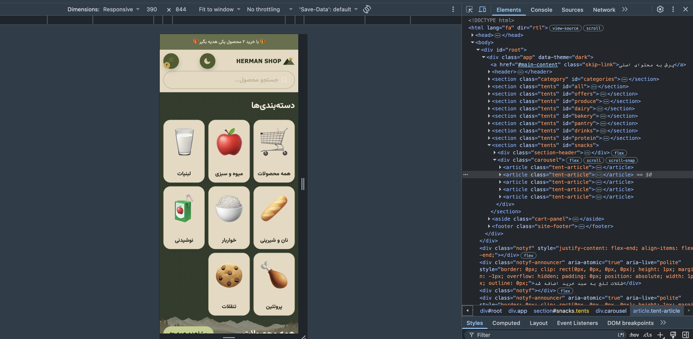

# Herman Shop

Herman Shop is a Persian, right-to-left grocery shop built with React and TypeScript. It includes product categories, offers, product details, sorting, a persistent cart, and light and dark themes.

[Open the live shop](https://deadlock-shop-u6g1.vercel.app/)



[](https://github.com/rojinh84-lgtm/deadlock-shop/actions/workflows/deploy.yml)

## Run locally

```sh
npm install
npm run dev
```

## Run with Docker

```sh
docker build -t deadlock-shop .
docker run --rm -p 8080:80 deadlock-shop
```

Then open <http://localhost:8080>.

## Changelog

See [CHANGELOG.md](./CHANGELOG.md) for the changes included in version 1.0.0.
