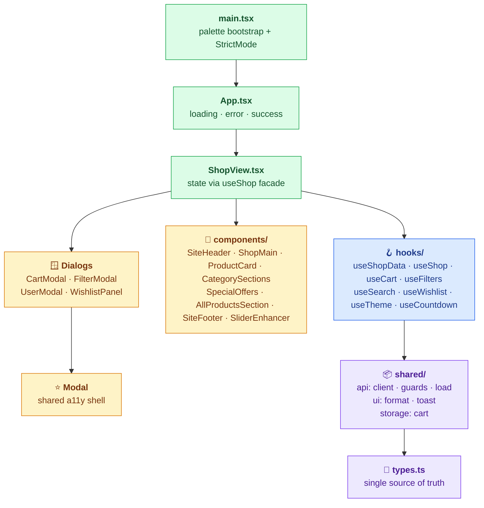
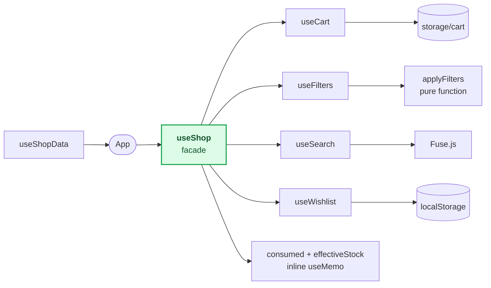

<div align="center">


# 🛒 سبزکاله

### فروشگاه آنلاین تازه، روز، به‌روز

**React 18 · TypeScript 5.9 · Vite 5 · Strict Mode · Zero `any`**

[](https://react.dev/)
[](https://www.typescriptlang.org/)
[](https://vitejs.dev/)

[](#-کیفیت-کد)
[](#-کیفیت-کد)
[](#-کیفیت-کد)
[](#-کیفیت-کد)
[](#-کیفیت-کد)

[](#-دسترسپذیری)
[](https://en.wikipedia.org/wiki/Right-to-left_script)
[](#-ریسپانسیو)
[](#-دسترسپذیری)

<!-- TODO: اسکرین‌شات یا GIF دمو رو اینجا بذار:

-->

<div dir="rtl">

[📖 درباره](#-درباره-پروژه) &nbsp;•&nbsp; [🏛 معماری](#-معماری) &nbsp;•&nbsp; [🚀 ویژگی‌ها](#-ویژگیها) &nbsp;•&nbsp; [📦 نصب و اجرا](#-نصب-و-اجرا) &nbsp;•&nbsp; [🧪 کیفیت کد](#-کیفیت-کد)

</div>

<sub><b>Week 5</b> · Gang of Forty · Deep Module</sub>

</div>

---

<div dir="rtl">

## 📖 فهرست مطالب

| 🧭 آشنایی                                                                                 | 🔬 جزئیات فنی                                                                                                   | 🏁 جمع‌بندی                                                                                                                                                        |
| ----------------------------------------------------------------------------------------- | --------------------------------------------------------------------------------------------------------------- | ------------------------------------------------------------------------------------------------------------------------------------------------------------------ |
| [درباره پروژه](#-درباره-پروژه)<br>[معماری](#-معماری)<br>[ساختار پوشه‌ها](#-ساختار-پوشهها) | [تکنولوژی‌ها](#-تکنولوژیها)<br>[ویژگی‌ها](#-ویژگیها)<br>[دسترس‌پذیری](#-دسترسپذیری)<br>[ریسپانسیو](#-ریسپانسیو) | [نصب و اجرا](#-نصب-و-اجرا)<br>[کیفیت کد](#-کیفیت-کد)<br>[تصمیم‌های طراحی](#-تصمیمهای-طراحی)<br>[درس‌های این هفته](#-درسهای-این-هفته)<br>[آمار پروژه](#-آمار-پروژه) |

---

## ✨ درباره پروژه

**سبزکاله** یک فروشگاه آنلاین مواد غذایی تازه است — میوه، سبزی، لبنیات، نان و خواروبار. این نسخه، بازنویسی کامل هفته‌ی چهارم روی معماری **React Hooks** است.

> [!NOTE]
> هفته‌ی چهارم یک پروژه‌ی ۵۱ فایلی Vanilla TS با ۷ لایه بود. این هفته تصمیم گرفتیم UI رو به React منتقل کنیم، اما **بدون اینکه به الگوهای بد برگردیم.**

**🚫 چیزهایی که نمی‌خواستیم**

- ❌ نه `any` برای فرار از تایپ‌ها
- ❌ نه `useEffect` برای هر چیزی که می‌شد در render حل کرد
- ❌ نه prop drilling تا ته درخت

**✅ چیزهایی که می‌خواستیم**

- ✅ تایپ‌های `strict` + `noUncheckedIndexedAccess` + `exactOptionalPropertyTypes`
- ✅ Type Guard برای داده‌های خارجی (`unknown` ← type-safe)
- ✅ Modal با focus trap + Escape + scroll lock
- ✅ `AbortSignal` همه‌جا برای fetch

### 🎯 اهداف این هفته

| هدف                                                  | وضعیت |
| ---------------------------------------------------- | :---: |
| مهاجرت به React Hooks بدون از دست دادن منطق          |  ✅   |
| حفظ Type Safety در سطح هفته چهارم                    |  ✅   |
| دسترس‌پذیری واقعی (نه فقط `aria-label`)              |  ✅   |
| صفر `any`، صفر `@ts-ignore`، صفر `as` برای ساکت کردن |  ✅   |
| حذف abstractionهای غیرضروری                          |  ✅   |
| یک Modal مشترک به‌جای چهار کپی                       |  ✅   |

---

## 🏛 معماری

نمای لایه‌ای پروژه، از نقطه‌ی ورودی تا تایپ‌ها:



### 🧩 چرا `useShop` یک facade است؟

به‌جای اینکه هر کامپوننت جداگانه `useCart`، `useFilters` و `useWishlist` صدا بزنه، `useShop` همه‌شون رو جمع می‌کنه و به `ShopView` می‌ده. این کار:

- **prop drilling** رو کم می‌کنه
- **هماهنگی** بین stateها رو آسان می‌کنه (مثلاً stock بعد از checkout)
- **یک جواب واضح** به «منطق کجاست؟» می‌ده

### 🔗 گراف وابستگی hooks



> [!TIP]
> `useConsumedStock`، `useEffectiveStock` و `useShopActions` در این هفته با `useShop` **ادغام** شدن. هر کدوم فقط یه لایه‌ی نازک روی همون state بودن، و ادغامشون ۳ فایل + ۳ لایه‌ی indirection رو حذف کرد.

---

## 📁 ساختار پوشه‌ها

<details>
<summary><b>📂 نمایش ساختار کامل پروژه</b></summary>

<br>

<div dir="ltr">

```text
shops/deep-module/
├── index.html                    ← ورودی Vite
├── style.css                     ← design system (oklch + light-dark)
├── package.json
├── tsconfig.json                 ← strict + noUncheckedIndexedAccess
├── vite.config.ts                ← base: './' + proxy
├── DESIGN.md                     ← سند معماری
├── README.md                     ← همین فایل
│
├── src/
│   ├── types.ts                  ← همه‌ی تایپ‌ها (بدون import)
│   ├── main.tsx                  ← palette + StrictMode
│   ├── App.tsx                   ← loading/error/success
│   │
│   ├── hooks/
│   │   ├── useShopData.ts        ← fetch + AbortSignal + retry
│   │   ├── useShop.ts            ← facade + filtered + stock
│   │   ├── useCart.ts            ← localStorage + confetti + toast
│   │   ├── useFilters.ts         ← filter state + pure applyFilters
│   │   ├── useSearch.ts          ← Fuse.js (fuzzy, threshold 0.35)
│   │   ├── useWishlist.ts        ← toggle + toast
│   │   ├── useTheme.ts           ← dark/light + system preference
│   │   └── useCountdown.ts       ← 24h sale timer + localStorage
│   │
│   ├── components/
│   │   ├── Modal.tsx             ← ⭐ shared a11y shell
│   │   ├── ShopView.tsx          ← top-level layout
│   │   ├── ShopMain.tsx          ← main content sections
│   │   ├── SiteHeader.tsx        ← header + search + actions
│   │   ├── SiteFooter.tsx
│   │   ├── TopBar.tsx
│   │   ├── MainNav.tsx           ← mobile menu + mega menu
│   │   ├── SearchBox.tsx         ← fuzzy suggestions + scroll
│   │   ├── Hero.tsx
│   │   ├── HeroCards.tsx
│   │   ├── HeroVisual.tsx
│   │   ├── Logo.tsx              ← inline SVG
│   │   ├── ThemeIcon.tsx
│   │   ├── CategoriesSection.tsx
│   │   ├── CategorySections.tsx  ← per-category sliders
│   │   ├── CategorySlider.tsx    ← Swiper
│   │   ├── SpecialOffers.tsx     ← Swiper
│   │   ├── BannersSection.tsx
│   │   ├── AllProductsSection.tsx ← pagination + sort
│   │   ├── ProductCard.tsx
│   │   ├── ProductGrid.tsx
│   │   ├── CartModal.tsx
│   │   ├── CartPanel.tsx
│   │   ├── CartItemRow.tsx
│   │   ├── WishlistPanel.tsx
│   │   ├── FilterModal.tsx
│   │   ├── UserModal.tsx
│   │   ├── SaleCountdown.tsx
│   │   ├── SaleCountdownToggle.tsx
│   │   └── SliderEnhancer.tsx    ← dock controls for Swiper
│   │
│   └── shared/
│       ├── api/
│       │   ├── client.ts         ← fetch + timeout + retry + AbortSignal
│       │   ├── guards.ts         ← type guards برای unknown
│       │   └── load.ts           ← loadAll + LoadState
│       ├── ui/
│       │   ├── format.ts         ← formatPrice + faNum + safeHref
│       │   └── toast.ts          ← Notyf wrapper
│       └── storage/
│           └── cart.ts           ← load/save + runtime validation
│
└── .github/
    └── workflows/
        ├── check.yml             ← tsc + oxlint
        └── deploy.yml            ← GitHub Pages
```

</div>

</details>

---

## 🛠 تکنولوژی‌ها

| پکیج              | نسخه | کاربرد                          | حجم (gzip) |
| ----------------- | :--: | ------------------------------- | :--------: |
| `react`           | 18.3 | UI                              |   ~۴۵ KB   |
| `react-dom`       | 18.3 | renderer                        |     —      |
| `vite`            | 5.4  | dev + build                     |     —      |
| `typescript`      | 5.9  | type safety                     |     —      |
| `swiper`          | 14.4 | carousels (offers + categories) |   ~۱۰ KB   |
| `fuse.js`         | 7.5  | fuzzy search                    |   ~۸ KB    |
| `notyf`           | 3.10 | toast notifications             |   ~۳ KB    |
| `canvas-confetti` | 1.9  | checkout celebration            |   ~۶ KB    |

> [!IMPORTANT]
> **Total runtime (gzip): ~۷۲ KB** — بدون احتساب فونت.

### ⚙️ تنظیمات TypeScript

<div dir="ltr">

```jsonc
{
  "strict": true,
  "noUncheckedIndexedAccess": true,
  "exactOptionalPropertyTypes": true,
  "noUnusedLocals": true,
  "noUnusedParameters": true,
  "noFallthroughCasesInSwitch": true,
  "verbatimModuleSyntax": true,
  "erasableSyntaxOnly": true,
}
```

</div>

> [!NOTE]
> دیگه هیچ `noImplicitAny: false`ای توی پروژه نیست. `strict: true` از هفته‌ی چهارم به بعد اجباریه.

---

## 🚀 ویژگی‌ها

### 🛒 خرید

- [x] سبد خرید کامل (+ / − / حذف / تسویه)
- [x] ذخیره‌ی سبد در `localStorage` با runtime validation
- [x] محدودیت موجودی با پیام toast واقعی
- [x] افکت confetti روی checkout
- [x] موجودی مصرف‌شده پس از خرید (stock کاهش می‌یابد)

### 🔍 جستجو

- [x] Fuse.js fuzzy search با `threshold: 0.35`
- [x] نرمال‌سازی فارسی (ی / ک / اعراب / ZWJ)
- [x] سقف ۵ پیشنهاد
- [x] کلیک روی پیشنهاد ← query ست می‌شه + scroll به grid
- [x] Enter ← scroll به All Products

### 🎯 فیلتر

- [x] دسته‌بندی / موجودی / تخفیف / مرتب‌سازی
- [x] اعمال فقط روی All Products
- [x] SpecialOffers و CategorySections دست‌نخورده می‌مونن
- [x] query در grid هم اعمال می‌شه

### ❤️ علاقه‌مندی‌ها

- [x] toggle از کارت (بدون نیاز به باز کردن پنل)
- [x] ذخیره در `localStorage`
- [x] badge روی هدر
- [x] پنل کامل با حذف + افزودن به سبد

### 🎨 طراحی

- [x] تم روشن/تاریک + `prefers-color-scheme`
- [x] ۶ palette (fresh / lime / ocean / violet / rose / amber)
- [x] `oklch` + `light-dark()` در CSS
- [x] فونت Vazirmatn (local، ۴ وزن)
- [x] RTL کامل
- [x] skip link

### ⏱ شمارنده

- [x] ۲۴ ساعته با `localStorage`
- [x] interval با `clearInterval` روی unmount
- [x] `SaleCountdownToggle` برای دموی lifecycle

---

## ♿ دسترس‌پذیری

| قابلیت                   | پیاده‌سازی                                        |
| ------------------------ | ------------------------------------------------- |
| Skip link                | `<a href="#main" class="skip-link">` در `App.tsx` |
| Focus trap               | `Modal.tsx` — Tab/Shift+Tab چرخشی                 |
| Escape to close          | `Modal.tsx` — با ref پایدار به `onClose`          |
| Scroll lock              | `Modal.tsx` — body با scrollbar compensation      |
| Focus restore            | `Modal.tsx` — برگشت به عنصر قبلی                  |
| `aria-modal`             | همه‌ی مودال‌ها                                    |
| `role="alert"`           | error state در `App.tsx`                          |
| `role="status"`          | loading state در `App.tsx`                        |
| `aria-expanded`          | `SearchBox`                                       |
| `aria-pressed`           | Theme toggle، Wishlist                            |
| `aria-checked`           | Sort control (radiogroup)                         |
| `aria-current`           | Dots در `SliderEnhancer`                          |
| `prefers-reduced-motion` | همه‌ی transitionها                                |
| کنتراست WCAG AA          | تمام متن‌ها                                       |

### 🪟 الگوی Modal

<div dir="ltr">

```tsx
// Modal.tsx — ۵ ثانیه‌ای درک می‌شه
const focusables = () =>
  Array.from(contentRef.current?.querySelectorAll(FOCUSABLE_SELECTOR) ?? []);

// Tab loop
if (e.key === "Tab") {
  const items = focusables();
  if (e.shiftKey && active === items[0]) last.focus();
  else if (!e.shiftKey && active === items[items.length - 1]) first.focus();
}
```

</div>

---

## 📱 ریسپانسیو

| breakpoint | چه اتفاقی می‌افته                    |
| :--------: | ------------------------------------ |
| **320px**  | تک‌ستونه، فونت کوچک‌تر، منوی همبرگری |
| **480px**  | کارت‌ها ۲ ستونه                      |
| **640px**  | هدر جستجو زیر برند                   |
| **768px**  | tablet — منوی افقی، Swiper 2-up      |
| **1024px** | desktop — grid 4 ستونه               |
| **1280px** | container 1280                       |
| **1920px** | container 1440                       |

<div dir="ltr">

```css
@media (prefers-reduced-motion: reduce) {
  *,
  ::before,
  ::after {
    animation: none !important;
    transition-duration: 0.01ms !important;
  }
}
```

</div>

---

## 📦 نصب و اجرا

### نیازمندی‌ها

- **Node.js** ≥ 18
- **npm** ≥ 9

### نصب

<div dir="ltr">

```bash
cd shops/deep-module
npm install
npm run dev
```

</div>

### دستورات

| دستور             | کاربرد        | نتیجه                    |
| ----------------- | ------------- | ------------------------ |
| `npm run dev`     | dev server    | `http://localhost:5173/` |
| `npm run check`   | tsc           | 0 errors                 |
| `npm run lint`    | oxlint        | 0 warnings               |
| `npm run build`   | production    | `dist/`                  |
| `npm run preview` | preview build | `http://localhost:4173/` |

### Environment variables

<div dir="ltr">

```bash
# .env.development  → dev proxy
VITE_API_URL=/api

# .env.production   → relative path for GH Pages
VITE_API_URL=../../api
```

</div>

---

## 🧪 کیفیت کد

<div dir="ltr">

```text
$ npm run check
$ tsc --noEmit
# ✓ 0 errors

$ npm run lint
$ oxlint src
# ✓ 0 warnings, 0 errors
```

</div>

| متریک               | مقدار |
| ------------------- | :---: |
| TypeScript errors   | **0** |
| oxlint warnings     | **0** |
| `any` در کد         | **0** |
| `@ts-ignore`        | **0** |
| `as` برای ساکت کردن | **0** |
| فایل‌های `src/`     |  ~۴۷  |
| هوک‌های سفارشی      |   ۸   |

---

## 🎯 تصمیم‌های طراحی

### ۱. `unknown` نه `any`

<div dir="ltr">

```ts
// shared/api/client.ts
export async function getJSON(path: string): Promise<unknown> {
  // ...
}
```

</div>

هر پاسخ API از `unknown` عبور می‌کنه و با Type Guardها به تایپ واقعی تبدیل می‌شه:

<div dir="ltr">

```ts
// shared/api/guards.ts
export function isProduct(v: unknown): v is Product {
  if (!isRecord(v)) return false;
  return (
    typeof v.id === "number" &&
    Number.isInteger(v.id) &&
    v.id > 0 &&
    typeof v.name === "string" &&
    v.name.length > 0 &&
    typeof v.price === "number" &&
    Number.isFinite(v.price) &&
    v.price >= 0
  );
}
```

</div>

### ۲. `LoadState<T>` به‌جای booleanهای متعدد

<div dir="ltr">

```ts
export type LoadState<T> =
  | { status: "loading" }
  | { status: "error"; message: string; kind: ApiErrorType }
  | { status: "success"; data: T };
```

</div>

`switch` + `assertNever` ← کامپایلر مطمئن می‌شه همه‌ی حالت‌ها پوشش داده شدن.

### ۳. Modal مشترک، نه ۴ کپی

قبل از این هفته، `CartModal`، `FilterModal`، `UserModal` و `WishlistPanel` هر کدوم یه shell تکراری داشتن — هیچ‌کدوم focus trap یا Escape نداشتن. حالا `Modal.tsx` تنها، ۵ قابلیت a11y حیاتی رو تأمین می‌کنه.

### ۴. حذف abstractionهای غیرضروری

هفته‌ی چهارم `useConsumedStock`، `useEffectiveStock` و `useShopActions` رو داشت. این هفته هر سه در `useShop` ادغام شدن — چون فقط یه زنجیره‌ی نازک روی همون state بودن.

### ۵. Refs برای callbackهای پایدار

<div dir="ltr">

```ts
const cartRef = useRef(cart.cart);
useEffect(() => {
  cartRef.current = cart.cart;
}, [cart.cart]);

const handleCheckout = useCallback(() => {
  // از cartRef.current استفاده می‌کنه، نه cart مستقیم
}, [cart.checkout]);
```

</div>

> [!TIP]
> نتیجه: `handleCheckout` هویت ثابت داره ← `ProductCard`ها دوباره render نمی‌شن.

---

## 🎓 درس‌های این هفته

|  #  | درس                                                                                                                      |
| :-: | ------------------------------------------------------------------------------------------------------------------------ |
|  ۱  | **`setState` + side effect = باگ** — فلگ `wasAdded` داخل `setIds` کار نمی‌کرد چون updater می‌تونه دوبار اجرا بشه         |
|  ۲  | **`AnimationController` ≠ Destructor** — `autoAnimate()` یه آبجکت با `destroy` برمی‌گردونه، نه یه cleanup function       |
|  ۳  | **`AbortSignal` رو از بالا بفرست** — بدونش، `setState` روی کامپوننت unmount شده فراخوانی می‌شد                           |
|  ۴  | **`role="tab"` بدون `tabpanel` = a11y خراب** — sort control باید `radiogroup` باشه                                       |
|  ۵  | **`exactOptionalPropertyTypes` بی‌رحمه** — `{ signal?: AbortSignal }` و `{ signal: AbortSignal \| undefined }` یکی نیستن |
|  ۶  | **`filtered` بدون query ممویز شده = باگ** — `applyFilters` هر رندر اجرا می‌شد                                            |
|  ۷  | **`git add .` از روت = فاجعه** — فایل‌های تیم‌های دیگه commit می‌شن                                                      |
|  ۸  | **force push روی branch مشترک = ممنوع** — `--force-with-lease` حداقل                                                     |

---

## 📊 آمار پروژه

| مورد                | مقدار  |
| ------------------- | :----: |
| فایل‌های TypeScript |  ~۴۷   |
| هوک‌های سفارشی      |   ۸    |
| کامپوننت‌ها         |   ۳۲   |
| فایل‌های `shared/`  |   ۷    |
| حجم JS (gzip)       | ~۷۲ KB |
| حجم CSS (gzip)      | ~۱۴ KB |
| TypeScript errors   |   ۰    |
| oxlint warnings     |   ۰    |
| `any` در کد         |   ۰    |
| `@ts-ignore`        |   ۰    |

---

## 🙏 تشکر

- [React Team](https://react.dev/) برای hooks
- [Vite](https://vitejs.dev/) برای DX
- [Swiper](https://swiperjs.com/) برای carousels
- [Fuse.js](https://www.fusejs.io/) برای جستجوی فارسی
- [Notyf](https://carlosroso.com/notyf/) برای toast
- [Canvas Confetti](https://github.com/catdad/canvas-confetti) برای لحظه‌ی checkout

</div>

---

<div align="center">

**ساخته شده با ❤️ و TypeScript strict**


<br>

**Developer:** Arman Gholamali &nbsp;·&nbsp; **Week:** 5 — Gang of Forty &nbsp;·&nbsp; **Architecture:** React Hooks · Strict TS · A11y First


</div>
