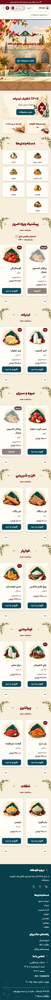

# Tazeh Khaneh | Online Grocery Store


Tazeh Khaneh is an online grocery store built during my Frontend Bootcamp. It has a Persian RTL design and works on desktop and mobile devices.

**[Live Website](https://idempotency-shop.vercel.app)**

## Mobile Preview



## Features

- Responsive design
- Product search and filtering
- Shopping cart
- Light and dark mode
- Products loaded from an API
- Page navigation

## Technologies

React, TypeScript, Vite, Zustand, TanStack Router, Fuse.js, Docker, Nginx, GitHub Actions, and Vercel.

## Run Locally

From the shared Bootcamp repository:

```bash
cd shops/idempotency
npm install
npm run dev
```

## Run with Docker

Run these commands from the shop folder:

```bash
docker build -t idempotency-shop .
docker run --rm -p 8080:80 idempotency-shop
```

Open `http://localhost:8080` in your browser.

## GitHub Container Registry

Pushes to `main` in the standalone `Baran-06/idempotency-shop` repository publish
`ghcr.io/baran-06/idempotency-shop` after CI and the Docker build pass. Each
publish uses the version from `package.json` (for example, `1.0.0`) and also
updates the `latest` tag.

After the first publish, set the package visibility to **Public** in GitHub's
package settings so users can pull the image without signing in.

```bash
docker pull ghcr.io/baran-06/idempotency-shop:latest
docker run --rm -p 8080:80 ghcr.io/baran-06/idempotency-shop:latest
```

Open `http://localhost:8080` in your browser. Replace `latest` in both commands
with a version tag to run a specific release.

## CI/CD

Run the project checks with:

```bash
npm run ci
```

GitHub Actions checks the code, builds the Docker image, and deploys the website to Vercel.

## Version

Current version: `1.0.0`

See [CHANGELOG.md](CHANGELOG.md) for version history.
