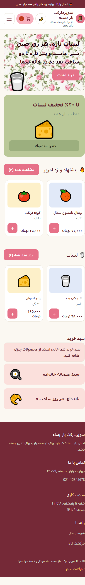

# سوپرمارکت باز-بسته


فروشگاه آنلاین لبنیات با React، TypeScript و Vite؛ سبد خرید، تم تیره و روشن و صفحهٔ فهرست محصولات.

**آدرس زنده:** https://open-close-shop.vercel.app



## اجرا

```bash
npm install
npm run dev
```

سپس `http://localhost:5173` را باز کنید. برای بررسی کامل (lint، check، build): `npm run ci`

## اجرا با Docker

```bash
docker build -t open-closed-shop .
docker run -d -p 8080:80 --name shop open-closed-shop
```

سپس `http://localhost:8080` را باز کنید. برای توقف:

```bash
docker stop shop && docker rm shop
```