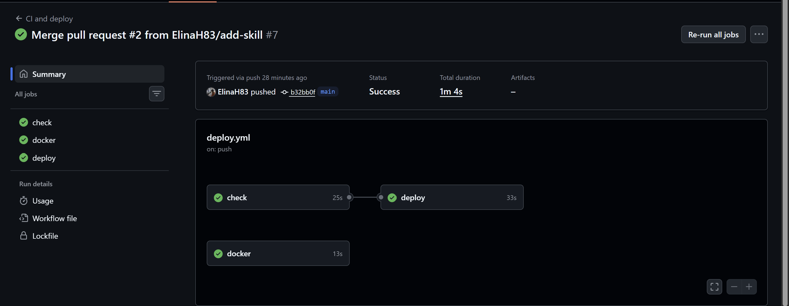

# سوپرینو

سوپرمارکت آنلاین با تنوع بسیار.

زبان‌های برنامه‌نویسی: React + Typescript

## لینک زنده

[مشاهده‌ی فروشگاه](https://premature-optimization-shop.vercel.app/)

## تصویر


## اجرا

```bash
npm install
npm run dev
```

سپس آدرسی که Vite در ترمینال نشان می‌دهد (معمولاً `http://localhost:5173`) را باز کنید.

## اجرا با Docker

۱. ساخت ایمیج:

```bash
docker build -t premature-optimization-shop .
```

۲. اجرای کانتینر:

```bash
docker run --rm -p 8080:80 premature-optimization-shop
```

۳. باز کردن `http://localhost:8080` در مرورگر.

## Pipeline

وضعیت ساخت و استقرار خودکار (GitHub Actions) در نشان بالای صفحه نمایش داده می‌شود:


