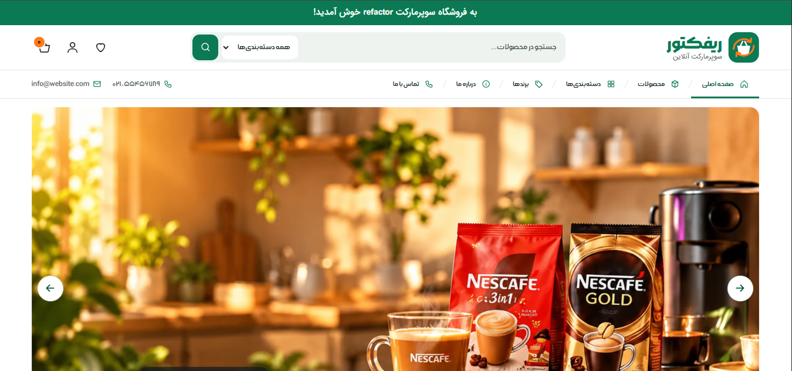
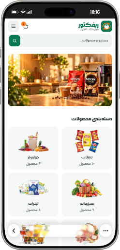
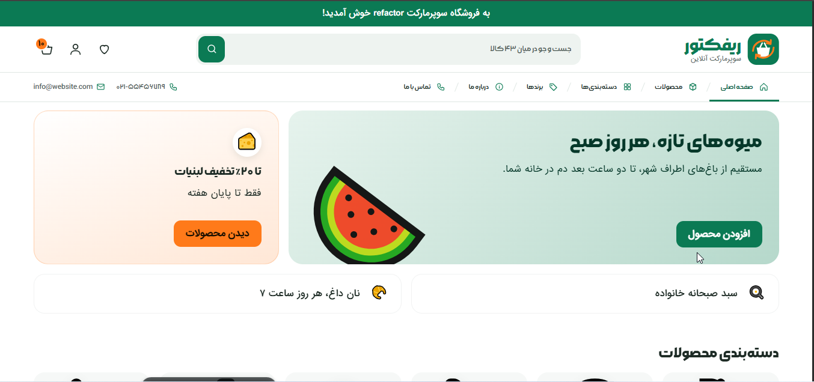
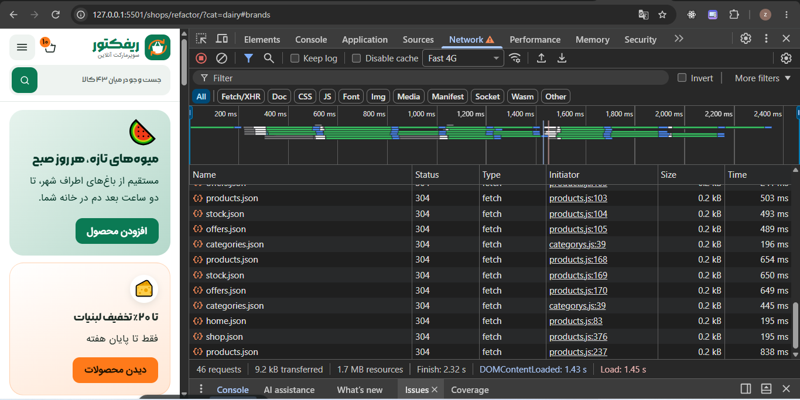
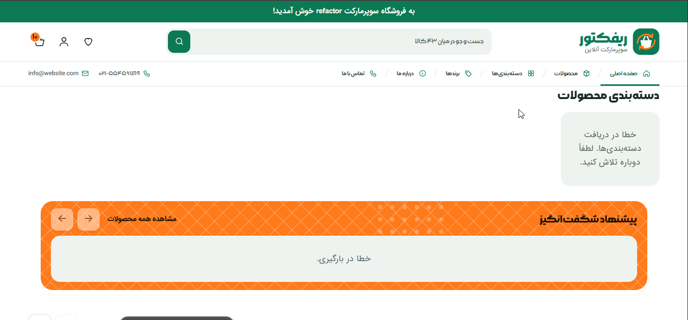
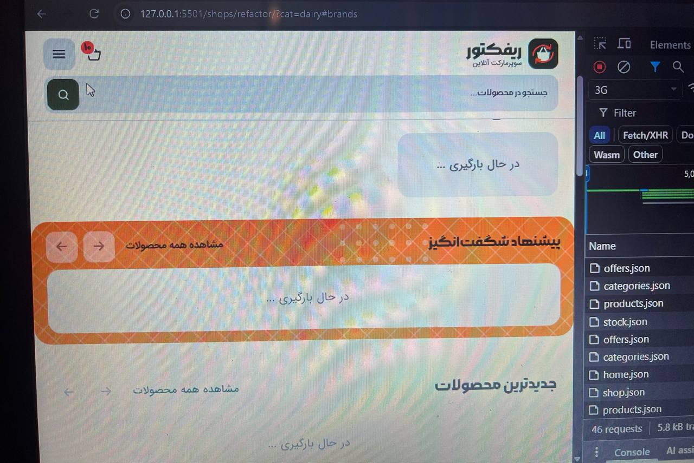

# 🛒 Refactor — صفحه فروشگاه

## ۱) اسکرین‌شات‌ها





---

## ۲) انیمیشن‌ها

توی صفحه چندتا انیمیشن داریم. این جدوله که نشون می‌ده هر انیمیشن چیکار می‌کنه:

| انیمیشن | چی عوض می‌شه | چطور اجرا می‌شه |
|---|---|---|
| بنر بالای صفحه | شفافیت | Composite |
| بالا اومدن کارت وقتی روش موس می‌ره | جابه‌جایی ۴ پیکسل به بالا | Composite |
| سایهٔ کارت | شفافیت | Composite |
| منوی موبایل | شفافیت و جابه‌جایی | Composite |
| حرکت کاروسل | اسکرول خود مرورگر | بدون محاسبهٔ مجدد |
| دکمه‌ها وقتی روش موس می‌ره | رنگ پس‌زمینه و متن | Paint |

انیمیشن‌هایی که با `transform` و `opacity` درست کردم، چون این دوتا خیلی سبک‌ان و مرورگر راحت اجراشون می‌کنه. عمداً از تغییر چیزهایی مثل `width`، `height` و موقعیت عناصر که باعث می‌شن مرورگر کل صفحه رو دوباره حساب کنه، خودداری کردم.

### سایهٔ کارت

سایهٔ کارت رو مستقیم با `box-shadow` انیمیت نکردم؛ به جاش از `opacity` روی یه pseudo-element استفاده کردم (چون `box-shadow` سنگینه).

### کاهش حرکت

اگه کاربر تنظیمات سیستمش رو روی حرکت کمتر (`prefers-reduced-motion`) گذاشته باشه، انیمیشن‌ها کمتر یا کلاً خاموش می‌شن تا راحت‌تر باشه.

---

## ۳) بنر بالای صفحه

توی بنر بالای صفحه، نمایش و مخفی شدن کنترل‌ها با `visibility` و شفافیت انجام می‌شه. تغییر `visibility` کل صفحه رو دوباره حساب نمی‌کنه، ولی ممکنه یه (Paint) کوچیک داشته باشه.

## ۴) منوی موبایل

منوی موبایل بدون JavaScript و فقط با این دوتا کار می‌کنه:

- `<input type="checkbox">`
- `<label>`

یعنی یه چک‌باکس مخفی داریم و با کلیک روی label، منو باز و بسته می‌شه.

وقتی منو بسته‌ست، این ویژگی‌ها رو داره:

```css
opacity: 0;
visibility: hidden;
transform: translateY(-8px);
```

`visibility: hidden` باعث می‌شه منوی مخفی نه با موس بشه باهاش کار کرد و نه با کیبورد فوکوس بگیره.

### زیرمنوی دسکتاپ

زیرمنوی دسکتاپ هم علاوه بر اینکه با موس باز می‌شه (`:hover`)، با کیبورد هم باز می‌شه (`:focus-within`) تا کاربرای کیبورد هم بتونن ازش استفاده کنن.

## ۵) URL Fragment (اون # توی آدرس)

اون قسمتی که بعد از `#` توی URL میاد، به سرور فرستاده نمی‌شه و مرورگر خودش مدیریتش می‌کنه.

مثلاً:

```
#dairy
```

باعث می‌شه مرورگر توی همون صفحه بره سراغ عنصری که `id="dairy"` داره. یعنی صفحهٔ جدیدی لود نمی‌شه، فقط می‌ره پایین‌تر.

با `:target` هم می‌شه اون بخش مقصد رو موقع ورود مشخص کرد (مثلاً رنگش رو عوض کرد).

مثلاً:

```css
#dairy:target {
  /* styles */
}
```

## ۶) کاروسل بدون JavaScript

**حرکت:** کاروسل با قابلیت‌های خود مرورگر ساخته شده.

این ویژگی:

```css
overflow-x: auto;
```

امکان اسکرول افقی رو می‌ده، و:

```css
scroll-snap-type: x mandatory;
```

باعث می‌شه موقعیت اسکرول روی نقاط مشخص‌شدهٔ کارت‌ها بشینه.

**دکمه‌ها:** دکمه‌های کاروسل با قابلیت‌های pseudo-elementها ساخته شدن:

```css
::scroll-button(inline-start)
::scroll-button(inline-end)
```

بنابراین برای کنترل حرکت کاروسل نیازی به JavaScript نیست.

## ۷) دسترس‌پذیری (Accessibility)

برای اینکه همه بتونن از صفحه استفاده کنن (حتی کسایی که مشکل بینایی یا حرکتی دارن) این کارا انجام شده:

- یه لینک "پرش به محتوای اصلی" گذاشتم که موقع استفاده از کیبورد دیده می‌شه.
- یه `h1` اصلی داریم و ترتیب Headingها (`h2`، `h3`، `h4`) رعایت شده.
- برای تصاویر معنادار، `alt` مناسب گذاشتم.
- برای کنترل‌ها و عناصر تعاملی، `aria-label` گذاشتم.
- اندازهٔ دکمه‌ها و لینک‌ها مناسب هست که با انگشت هم راحت بشه زد.
- رنگ متن و پس‌زمینه کنتراست کافی دارن.
- از `prefers-reduced-motion` پشتیبانی می‌کنه.
- منوی دسکتاپ با کیبورد هم باز می‌شه (`:focus-within`).

## ۸) لوگو

اجزای اصلی لوگو اینان:

- یه مستطیل سبز با گوشه‌های گرد (پس‌زمینهٔ آیکون)
- یه شکل سفید برای بدنهٔ سبد
- یه شکل سفید برای دستهٔ سبد
- چهارتا فلش نارنجی چرخشی (نشون‌دهندهٔ مفهوم Refactor)
- دوتا متن برای اسم و شعار

**چرا SVG؟**

چون SVG برداریه، هرچی بزرگش کنی کیفیتش خراب نمی‌شه. همچنین می‌شه رنگ و شکل اجزاش رو با HTML و CSS عوض کرد.

---

## هفته دوم — تسک دوم
```


🛒 تسک فروشگاه — سطوح ۱ تا ۴
سطح ۱: یک کاروسل زنده (حداقل تحویل)
یکی از کاروسل‌های صفحه هفته اول را انتخاب کنید؛ برای مثال «لبنیات»، و کارت‌های دادهٔ آن را با دادهٔ API جایگزین کنید.

☑ محتوای کارت‌های آن کاروسل از HTML حذف شود؛ فقط ظرف خالی کاروسل در HTML بماند.
☑ فایل products.json با fetch یا async / await خوانده شود.
☑ محصولات با filter یا یک روش مشابه بر اساس categoryId جدا شوند.
☑ برای هر محصول یک کارت با همان ظاهر هفته اول ساخته شود؛ آیکون، نام، مقدار یا وزن، قیمت به تومان با اعداد فارسی و دکمه افزودن.
☑ کارت‌ها با createElement و textContent ساخته شوند؛ دادهٔ API هرگز مستقیم داخل innerHTML قرار نگیرد.
☑ رفتار کاروسل هفته اول (اسکرول افقی، ایستادن روی ابتدای کارت، RTL و دکمه‌های ابتدا و انتها) همچنان کار کند.
☑ تا وقتی داده نرسیده، یک پیام یا Skeleton «در حال بارگذاری» دیده شود.
☑ اگر درخواست شکست خورد (res.ok برابر false یا قطع اینترنت)، به‌جای کاروسل خالی یک پیام خطای قابل فهم نمایش داده شود.
راهنمایی: قیمت فارسی با جداکنندهٔ هزارگان

js
new Intl.NumberFormat('fa-IR').format(165000) // ۱۶۵٬۰۰۰
سطح ۲: پیشنهاد ویژه امروز
کاروسل «پیشنهاد ویژه امروز» را زنده کنید. این کاروسل به سه فایل نیاز دارد.

☑ فایل‌های products.json و stock.json و offers.json همزمان با Promise.all خوانده شوند.
☑ کاروسل فقط محصولاتی را نشان دهد که در offers.json تخفیف دارند.
☑ کارت تخفیف‌دار: برچسب درصد تخفیف، قیمت خط‌خورده و قیمت جدید.
☑ کارت ناموجود (موجودی ۰): کارت کم‌رنگ، برچسب «ناموجود»، و دکمه افزودن غیرفعال (disabled).
☑ کاروسل سطح ۱ هم از همین داده‌ها استفاده کند؛ اگر محصولی در آن کاروسل تخفیف دارد یا ناموجود است، همان‌طور ظاهر شود.
☑ برای پیدا کردن تخفیف و موجودی هر محصول، از find یا یک Map استفاده کنید.
سطح ۳: کل صفحه از روی داده
دسته‌بندی‌ها، منو، Header و Footer
☑ بخش دسته‌بندی‌ها از categories.json ساخته شود؛ آیکون با رنگ color و نام و لینک به #slug.
☑ منوی «همه دسته‌ها» و لینک‌های دسته در Footer از همان داده ساخته شوند.
☑ نوار اطلاع‌رسانی، شعار، منوی اصلی، درباره ما، آدرس، تلفن، ساعت کاری و کپی‌رایت از shop.json خوانده شوند (فقط بخش‌هایی که با فروشگاه شما جور است).
☑ لینک Fragment هر دسته (برای مثال #dairy) همچنان کاربر را به بخش درست ببرد، حتی بعد از اینکه بخش‌ها با JavaScript ساخته شده‌اند.
سقف تمرین
☑ بنرهای بالای صفحه و بنرهای تبلیغاتی از home.json ساخته شوند.
☑ کاروسل‌ها از فهرست home.json به Carousel ساخته شوند؛ اگر یک کاروسل جدید به این فهرست اضافه شود، بدون تغییر HTML در صفحه ظاهر شود.
☑ همه فایل‌ها با یک Promise.all خوانده شوند.
☑ دکمه افزودن تعداد سبد خرید در Header را زیاد کند و این عدد در localStorage ذخیره شود؛ بعد از Reload صفحه باقی بماند.
☑ متن جعبه جستجو تعداد واقعی کالاها را نشان دهد (برای مثال «جستجو در میان ۲۴ کالا...»).
☑ در HTML فقط اسکلت صفحه، لوگو و ظرف‌های خالی باقی بمانند.
سطح ۴: چالش‌های اختیاری
☑ با کلیک روی یک دسته، آدرس صفحه به ?cat=dairy تغییر کند و فقط محصولات همان دسته نمایش داده شوند (از history.pushState و URLSearchParams استفاده کنید).
☑ اگر API بیشتر از ۲ ثانیه جواب نداد، پیام «اتصال قطع است» نمایش دهید (در درس سوم استفاده کنید)، با Promise.race یا Promise.any.


```
## ۲) اسکرین‌شات‌ها






---

## 3) اسکرین‌شات‌ها




---
سوال 4

خیر fetchبرا خطاهای httpمثل 404خودکار وارد catchنمیشه برای تشخیص این خطا بررسی میکنیم اگه respose,ok برابر با falseبود یک خطای throwپرتاپ میکنیم

---
سوال 5
از textContent استفاده می‌کنیم چون داده‌های API قابل اعتماد نیستند و ممکن است حاوی کد مخرب باشند.
- امنیت: جلوگیری از حملات XSS.
- رفتار درست: داده به‌صورت متن نمایش داده می‌شود، نه HTML.
- سادگی: نیازی به پردازش و تفسیر HTML نیست.
مثلاً textContent متن را امن‌تر نمایش می‌دهد، اما innerHTML آن را به‌عنوان HTML تفسیر می‌کند.


---
سوال 6

چون برای نمایش محصولات به اطلاعات سه فایل products.json، stock.json و offers.json نیاز داریم. با Promise.all درخواست‌ها را هم‌زمان شروع می‌کنیم تا لازم نباشد برای پایان هر درخواست صبر کنیم و بعد درخواست بعدی را بفرستیم


پشت سر هم (sequential):

 زمان کل = زمان فایل ۱ + زمان فایل ۲ + زمان فایل ۳

 هم‌زمان با Promise.all:

زمان کل = بیشترین زمان بین سه فایل


در تب Network مرورگر، درخواست‌ها در حالت هم‌زمان معمولاً نزدیک به هم شروع می‌شوند؛ اما در روش پشت سر هم، درخواست بعدی پس از پایان مرحله قبلی شروع می‌شود. به همین دلیل، اجرای هم‌زمان می‌تواند زمان انتظار کلی را کاهش دهد.


