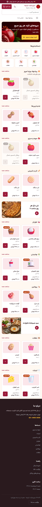

# Nardone

[](https://github.com/amirnasr-dev/semver-shop/actions/workflows/deploy.yml)

Nardone is a Persian, right-to-left storefront where shoppers can search for products, view prices, and build a shopping cart. [Open the live storefront](https://semver-shop.vercel.app/)

## Run locally

In your terminal, go to the directory containing Nardone's `package.json`. In the group repository, that directory is `shops/semver`. In the standalone `semver-shop` repository, use the repository root.

```powershell
npm install
npm run dev
```

After starting the server, open the address Vite prints in the terminal. The default is `http://localhost:5173`. In Windows PowerShell, you can use `npm.cmd` in place of `npm`.

## Run with Docker

Start Docker and run these commands from the same storefront directory.

```powershell
docker build -t semver-shop .
docker run -d -p 8080:80 --name shop semver-shop
```

Open `http://localhost:8080` in your browser. To check the API, open `http://localhost:8080/api/products.json` and confirm that it returns the product list as JSON.

## Mobile view


