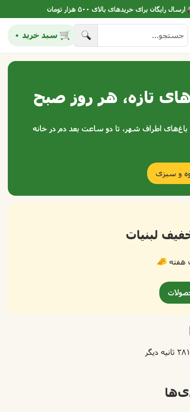

# yaldastore — سوپرمارکت محله (separation)

سوپرمارکت فارسی راست‌چین محله: میوه و سبزی، لبنیات و خواربار تازه.


- فروشگاه زنده: https://separation-ten.vercel.app
- نسخه: `1.0.0` — جزئیات در [CHANGELOG.md](./CHANGELOG.md)



## اجرا

```bash
npm install
npm run dev   # http://localhost:5173
```

## اجرا با Docker

```bash
docker build -t separation-shop .
docker run -d -p 8080:80 --name shop separation-shop
# http://localhost:8080 — مسیر /api/ محصولات را می‌آورد
docker stop shop && docker rm shop
```

## Pipeline

هر `Push` به `main` سه `job` را اجرا می‌کند: `check` (نصب دقیق + `npm run ci`)، `docker` (بیلد ایمیج) و `deploy` (انتشار روی Vercel).
