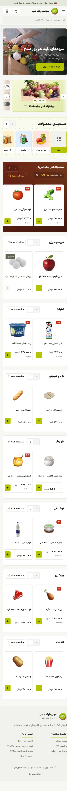

# Sharding · سوپرمارکت مینا

[](https://github.com/AlirezaArabshahi/sharding-shop/actions/workflows/deploy.yml)

Sharding is a Persian RTL grocery storefront for browsing products, managing a cart, and checking out.

[Live shop](https://sharding-shop.vercel.app) · [Changelog](CHANGELOG.md)

## Run locally

From the shop directory, install the dependencies and start Vite.

```bash
npm install
npm run dev
```

Open the local URL printed by Vite. Run `npm run ci` to run the repository checks and production build.

## Run with Docker

```bash
docker build -t sharding-shop .
docker run -d -p 8080:80 --name shop sharding-shop
```

Open [http://localhost:8080](http://localhost:8080).

## Mobile screenshot


