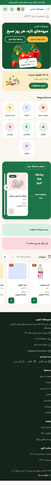

# Armin Supermarket (strategic)

Armin Supermarket is a Persian RTL grocery storefront where shoppers can browse products by category, search the catalog, and manage their cart.

[Open the live shop](https://strategic-shop.vercel.app/)

[](https://github.com/armin-panahi/strategic-shop/actions/workflows/deploy.yml)



## Run locally

From the shop directory, install the dependencies and start the development server:

```sh
npm install
npm run dev
```

Open the local URL printed by Vite in your terminal.

## Run with Docker

From the shop directory (`shops/strategic/`), build the image and start the container:

```sh
docker build -t strategic-shop .
docker run -d -p 8080:80 --name shop strategic-shop
```

Open [the shop](http://localhost:8080) in your browser. To check the API connection, open [the product catalog](http://localhost:8080/api/products.json). You should see a JSON list of products.

When you finish testing, stop and remove the container:

```sh
docker stop shop
docker rm shop
```
