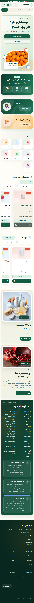

# Sam Market

[](https://github.com/Sami-gh05/tdd-shop/actions/workflows/deploy.yml)

A Persian grocery storefront with product search, category pages and a cart.

[Open the live shop](https://tdd-shop.vercel.app)



## Run locally

From this folder:

```sh
npm install
npm run dev
```

Open http://localhost:5173. Run `npm run ci` to check the project.

## Run with Docker

From this folder:

```sh
docker build -t tdd-shop .
docker run --rm -p 8080:80 tdd-shop
```

Open http://localhost:8080.

## Run the published image

```sh
docker run --rm -p 8080:80 ghcr.io/sami-gh05/tdd-shop:1.0.0
```

Open http://localhost:8080.
