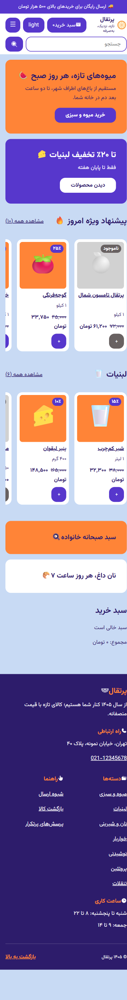

# Tracer Bullet


A Persian RTL online grocery shop built with React, TypeScript, and Vite, featuring product browsing, category and product pages, a persistent shopping cart, and light and dark themes.

## Live URL

https://tracer-bullet-shop.vercel.app/

## Mobile screenshot



## Run

Install dependencies:

```bash
npm install
```

Create a `.env.development` file in the shop directory with the following content:

```env
VITE_API_URL=/api
```

Start the development server:

```bash
npm run dev
```

Open http://localhost:5173 in your browser.

The Vite development server proxies `/api` requests to the Gang of Forty API.

## Run with Docker

Build the Docker image:

```bash
docker build -t tracer-bullet-shop .
```

Run the container:

```bash
docker run -d -p 8080:80 --name shop tracer-bullet-shop
```

Open http://localhost:8080 in your browser.

Stop and remove the container:

```bash
docker stop shop
docker rm shop
```

## Run the published Docker image

```bash
docker run -d -p 8080:80 --name shop ghcr.io/elenamomeni-art/tracer-bullet-shop:1.0.0
```

Open http://localhost:8080 in your browser.
