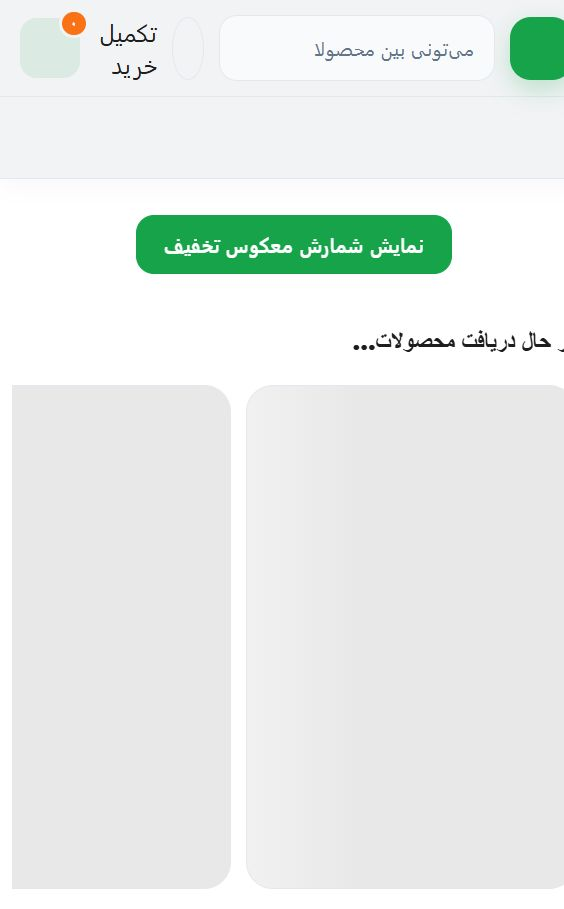

# مينا Store

مينا — سوپرمارکتی به وسعت قلبتان.

## Live Website

🔗 [مينا Store](https://yagni-shop.vercel.app)



## Run

```bash
npm install
npm run dev
```

Open http://localhost:5173

## Run with Docker

```bash
docker build -t yagni-shop .
docker run -d -p 8080:80 --name shop yagni-shop
# Open http://localhost:8080 and check the products and /api/
docker stop shop && docker rm shop
```

## Pipeline

[](https://github.com/Sipanyn/yagni-shop/actions/workflows/deploy.yml)
